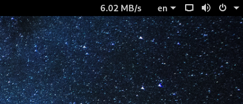

# ⇅ Internet Speed Meter

A simple and minimal Internet Speed Meter extension for the Gnome Shell.



To use this extension, you will need

- Gnome Shell 45 or later

### Install from Gnome Extensions

Visit [Internet Speed Meter - GNOME Shell Extensions](https://extensions.gnome.org/extension/2980/internet-speed-meter) 

### Install from source

1. Clone this repository

   ```bash
   git clone https://github.com/AlShakib/InternetSpeedMeter.git
   ```

2. Change current directory to repository

   ```bash
   cd InternetSpeedMeter
   ```

3. Now run

   ```bash
   chmod +x ./install.sh && ./install.sh --install
   ```

4. Log out and then log in, so that Gnome Shell finds the new extension. On an X11 session (Gnome 48 or earlier), you can instead press `ALT + F2`, type `r` and press `Enter`.

5. Enable **Internet Speed Meter** from the [Extension Manager](https://github.com/mjakeman/extension-manager), or run

   ```bash
   gnome-extensions enable InternetSpeedMeter@alshakib.dev
   ```

## Development

Gnome Shell loads `extension.js` only once per session. To test changed code without logging out, run it in a nested Gnome Shell:

```bash
./install.sh --nested
```

On Gnome 49 or later, this needs the `mutter-devkit` package (Fedora: `sudo dnf install mutter-devkit`).

Other options of `install.sh`:

- `--reload` installs the files and reloads only `stylesheet.css` in the running shell.
- `--build` creates the release ZIP in `out/`.

## Contributing

Pull requests are welcome. For major changes, please open an issue first to discuss what you would like to change.

## Thanks to

- Project Icon is made by [Freepik](https://www.flaticon.com/authors/freepik) from [www.flaticon.com](https://www.flaticon.com)

## License

[GNU General Public License v3.0](LICENSE)

Copyright © 2020 - 2024 [Al Shakib](https://alshakib.dev)
